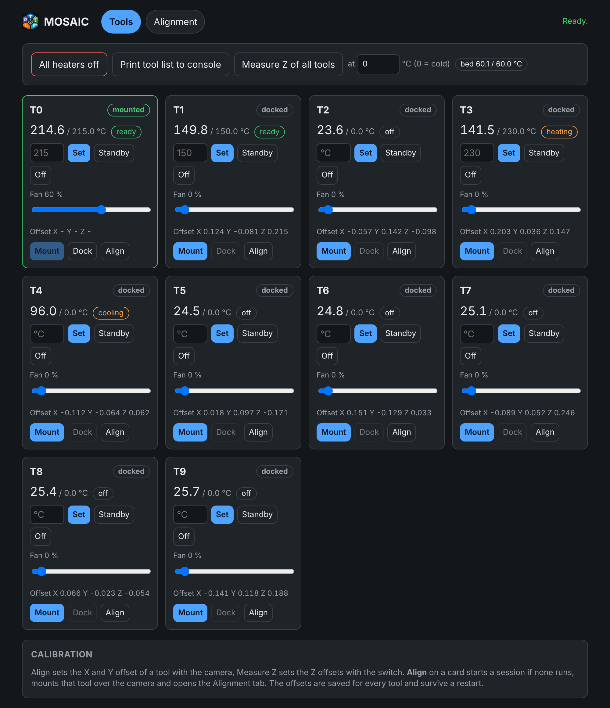

<p align="center">
  
</p>

# MOSAIC: Multi-Tool Offset Alignment & Integrated Calibration

One package for the tools of a tool changer on Klipper and Kalico: calibration, tool control and docking.
Every nozzle touches a small probe, the macros turn the touch points into the X, Y and Z offsets of each tool,
and you do nothing in between. The same package gives you the `T0` ... `T9` commands, the dock pick-up and
drop-off moves, and one web page to control it all.

It works with any tool changer that runs on **klipper-toolchanger** (Viesturz), such as MadMax (Zruncho), on
stock Klipper or Kalico. It does not depend on MadMax itself, only on klipper-toolchanger's tools and tool parameters.

- **XY and Z, automatic:** a [Nudge](https://github.com/zruncho3d/nudge) probe (a mechanical contact probe,
  about 10 dollars) sits on the bed. `MOSAIC_CALIBRATE` mounts every tool in turn, touches the Nudge from four
  sides and from above, and saves the offsets. The probing itself is klipper-toolchanger's `[tools_calibrate]`
  module; MOSAIC runs it for all tools, adds up the offsets and saves them.
- **Z with a separate switch (optional):** the Nudge is very repeatable in X and Y but less so in Z. If you
  want the best Z, add a plain switch that every nozzle presses from above (`[mosaic_z_probe]`) and MOSAIC
  takes Z from it.
- **Tools (optional):** `T0` ... `T9` commands and a Tools page for changers with several tools,
  including hotend swappers where every tool has its own heater and fan. Each tool shows the filament that is
  loaded (material, name, colour), has temperature buttons, and every tool change is timed and checked. While a
  print runs, the page compares the loaded filament with what the sliced file expects.
- **Docking (optional):** pick-up and drop-off for passive (Maxwell / kinematic) couplings, with a position and
  path per dock, a teach command, and checks of a carriage switch and one switch per dock around every change.
  Leave it out if your changer brings its own dock macros. Details in [docs/docking.md](docs/docking.md).

## Screenshots

<p align="center">
  
</p>

One card per tool with the loaded filament, temperature, temperature buttons, fan, offsets, mount, dock and
calibrate. On top, the filament check of the last file; below, the calibration buttons, the offsets and the tool
change log.

<p align="center">
  
</p>

The same page on a phone.

These screenshots show the real page running against a simulated printer: the temperatures and offsets are
made-up demo data, not a real machine.

## What is in the package

| File | What it does |
|---|---|
| `mosaic.cfg` | The calibration macros. |
| `mosaic_tools.cfg` | Optional. `T0` ... `T9`, per tool temperature commands, standby handling. |
| `mosaic_tool_heaters.cfg` | Optional. `M104` / `M109` with a `T` parameter for slicers. |
| `mosaic_dock.cfg` | Optional. The dock pick-up / drop-off engine. You do not edit it. |
| `mosaic_resume_guard.cfg` | Optional. Makes `RESUME` refuse after a failed tool change until `MOSAIC_RESUME` has repaired the changer. |
| `mosaic_shared_extruder.cfg` | Optional. For a hotend swapper with one shared extruder motor: makes `SET_PRESSURE_ADVANCE` act on that motor. |
| `config/` | The template of your `MOSAIC/mosaic.cfg`: settings, MOSAIC's probes, tools and their hardware, switches, dock positions. `install.sh` copies it once. |
| `docs/` | Hardware examples, the docking guide, and examples of dock layouts. |
| `klippy_extras/mosaic_z_probe.py` | Optional Klipper module for the separate Z switch. Works next to Beacon, Cartographer or any probe. |
| `ui/` | The web page (heaters, fans, mount, dock, offsets, calibration), its server, and the files `install.sh` uses to add it to Mainsail or Fluidd. |
| `assets/` | The logo, the hexagon emblem alone, and a 1280x640 social preview image (PNG). |
| `examples/mainsail/` | The Mainsail sidebar entry. |
| `install.sh` | Creates your MOSAIC folder, adds its one include line to `printer.cfg`, links the Z switch module, and sets up the web page with its Mainsail sidebar entry and update panel entry. |
| `uninstall.sh` | Undoes what `install.sh` set up. |

## Requirements

- Klipper or Kalico with **klipper-toolchanger** working (tools defined with `[tool T0]`, `[tool T1]`, ...), and its
  `tools_calibrate` module (it is part of klipper-toolchanger; Kalico ships its own copy).
  For the default offset method you need klipper-toolchanger **2025.12.26 or newer**
  (offsets as the tool parameters `gcode_x_offset`, `gcode_y_offset`, `gcode_z_offset`).
- A `[save_variables]` section.
- A **Nudge probe** on the bed, wired to a free endstop pin. Every nozzle must be able to reach it, and it must
  sit rigid: bolted to the bed frame or the printer, not on a flexing plate.
  Nudge needs about 6 mm of overtravel for the pin to wobble.
- Optional: a switch for Z.
- For the web page and the update panel: Moonraker with Mainsail or Fluidd (the standard KIAUH, MainsailOS or FluiddPi
  setup), and `sudo` rights for the installer. The sidebar entry is Mainsail only; Fluidd users bookmark the page.

## Installation

Everything MOSAIC lives in one folder, `MOSAIC`, in your Klipper config folder. `printer.cfg` gets a single line:

```
[include MOSAIC/mosaic.cfg]
```

**Before you start:** klipper-toolchanger has to be installed first, using its own installer. MOSAIC is built on it.

### 1. Get the files

On the printer's Pi or PC, over SSH, in your home folder (not in the config folder):

```
cd ~
git clone https://github.com/Slimohan/MOSAIC
```

### 2. Run the installer

```
cd MOSAIC
./install.sh
```

It does three things:

- **Creates your MOSAIC folder** (`~/printer_data/config/MOSAIC`) with your `mosaic.cfg`, and adds
  `[include MOSAIC/mosaic.cfg]` at the top of `printer.cfg` (a backup is kept as `printer.cfg.mosaic-backup`). It never
  overwrites a file of yours; if a template changed, the new one is saved beside yours with `.new` at the end.
- **Links the optional Z switch module** into `~/klipper` or `~/kalico`. You only need this if you add the separate Z
  switch. If your Klipper or Kalico is somewhere else, pass the path: `./install.sh /path/to/klipper`.
- **Sets up the MOSAIC page.** In Mainsail there is a **MOSAIC** entry in the sidebar after a reload; in Fluidd, open
  `http://<printer>/mosaic/` and bookmark it. The page is where you control and calibrate the tools. The installer
  asks for your password (sudo) for this part. Details in "The web page" below; skip it with `NO_WEB=1 ./install.sh`.

If your config folder is not `~/printer_data/config`: `CONF=/path/to/config ./install.sh`.

**Several printers on one computer** (KIAUH instances, each in `~/printer_<NAME>_data`): run the installer once per
printer that has a tool changer, with that printer's config folder:

```
CONF=~/printer_PICOTRAIN_data/config ./install.sh
```

It reads Moonraker's port from that printer's `moonraker.conf` and gives the printer its own page service
(`mosaic-PICOTRAIN`), page port (8099 plus the distance of its Moonraker port from 7125, so 8101 for port 7127),
page address (`http://<computer>/mosaic-PICOTRAIN/`, also in that printer's Mainsail sidebar) and update panel entry
(`[update_manager mosaic-PICOTRAIN]`, which restarts that printer's Klipper). All printers share the one download in
`~/MOSAIC`. A single `mosaic` service that was edited by hand to talk to the printer's Moonraker is found and replaced.
`INSTANCE=`, `MOONRAKER_PORT=` and `PAGE_PORT=` override what the installer works out. Uninstall the same way:
`CONF=~/printer_PICOTRAIN_data/config ./uninstall.sh`.

### 3. Fill in `mosaic.cfg`

In Mainsail open **Machine** (Fluidd: **Configuration**) and then the `MOSAIC` folder:

```
MOSAIC/
  mosaic.cfg   the one file you edit
  core/        MOSAIC itself, a link to ~/MOSAIC: never edit anything in here
```

`mosaic.cfg` has seven sections, from top to bottom:

1. **What to load**: MOSAIC itself; switch optional parts on or off here
2. **Settings**: at least the Nudge position
3. **MOSAIC's probes**: the Nudge probe, the optional Z switch, `[save_variables]`
4. **Toolchanger**: the `[toolchanger]` section with the dock hooks
5. **Tools**: the hardware of your tools (heaters, fans, motor) and one `[tool Tn]` per tool
6. **Switches**: your carriage and dock switches, or just their names if they live in your board file (optional)
7. **Dock positions**: where every dock is ([docs/docking.md](docs/docking.md))

The order matters: MOSAIC's T commands have to load before the tools, and your settings after MOSAIC. Move your
`[tool Tn]` sections and your `[toolchanger]` options from `printer.cfg` into sections 5 and 4. Each section explains
what goes into it, and Klipper refuses to start while a section you switched on still has `...` in it.

**Your hardware: two ways, both in `mosaic.cfg`.** MOSAIC works with any board and holds no board of its own. The
heaters, thermistors, fans, motors and switches of your tools are set up in sections 5 and 6, and which way you pick
is up to you:

- **A. Point at a file of your own.** Your board or toolhead has a config file (the one that came with your tool
  changer, say). Put it next to `printer.cfg` and add one line in section 5:
  `[include ../my_tools.cfg]`. Its sections can have any names; the `[tool Tn]` sections and, in section 6, the
  switch names refer to them. Changing boards means changing that file, never MOSAIC.
- **B. Define them in `mosaic.cfg`.** Section 5 has ready-made templates for the heaters and fans (a full toolhead
  per tool, or a hotend swapper with one shared extruder motor) and section 6 for the switches. Remove the hash
  signs and fill in your pins.

Examples, including complete board files: [docs/hardware.md](docs/hardware.md). Only `mosaic.cfg` is loaded from the
`MOSAIC` folder, so leftover copies and old files there do no harm.

**Taking a tool out:** put a hash sign in front of its `[tool Tn]` section in section 5 (and, if you defined it
there, its heater and fans, and its dock switch in section 6). Its saved offsets and filament stay saved.

**Updates** never touch `mosaic.cfg`. If the template changes, the new one is saved beside yours as `mosaic.cfg.new`,
so you can see what is new and copy it over.

**Coming from an older install** (the numbered `00_core.cfg` ... `90_settings.cfg` files)? The installer joins them
into one `mosaic.cfg` for you (in the same order they used to load) and moves the old files into `MOSAIC/old/`.

### 4. Restart Klipper and run `MOSAIC_CHECK`

It reports anything that is missing, including the docking (it runs `MOSAIC_DOCK_CHECK` at the end).

### Updating

The installer adds MOSAIC to the Moonraker update panel (Mainsail: **Machine** page, Fluidd: the software updates card), so it updates like Klipper and Moonraker. An
update only replaces `~/MOSAIC` (what `core/` points to); your files in the MOSAIC folder are never touched. Without
the update panel, run `git pull` in `~/MOSAIC` and restart Klipper. After an update, run `./install.sh` once more if the
release notes say a template changed: it saves the new template beside yours as `.new` for you to compare.

**Upgrading from the first release.** Your `mosaic.cfg` keeps working as it is: every new setting has a default, and the
new features stay off until you switch them on. To use them, take these from the new template: in section 4, `[toolchanger]`
gets `before_change_gcode: MOSAIC_BEFORE_CHANGE`, `after_change_gcode: MOSAIC_AFTER_CHANGE T={tool.tool_number}` and
`error_gcode: MOSAIC_TOOLCHANGE_ERROR` (remove a `SYNC_EXTRUDER_MOTION` line of yours and set `variable_motor` instead); in
section 2 the new settings (`motor`, `retract`, `pause_on_error`, `auto_init`, `max_offset_x/y/z`, ...); in section 7 `check_count`,
`accel_fast` and `accel_slow`, and for printers whose bed moves in Z or whose docks need other paths `z_mode`, `pickup_in` /
`dropoff_in`, `lane_guard`, `travel_accel` and `prime_before_restore` (all off or unchanged by default, see
[docs/docking.md](docs/docking.md)). A printer with `[pause_resume]` in `printer.cfg` gets the pause on a failed tool change.

## Setup, once

1. **Test the Nudge by hand.** Run `MOSAIC_NUDGE_QUERY` with the pin at rest: it must say `open`. Push the pin
   aside with a finger: `TRIGGERED`. If it is the other way round, add or remove the `!` in front of the pin.
2. **Find the position.** Home, mount the reference tool (T0) and move the nozzle above the middle of the Nudge
   pin, a few millimetres above the top of the pin. Write down the G-code X, Y and Z. They go into
   `nudge_x`, `nudge_y`, `nudge_z`. 1 to 2 mm off in X and Y is fine: the probing finds the centre itself. Z
   has to be higher than the pin plus the `lift_z` of `[tools_calibrate]` (1 mm by default).
3. **Check the other tools can reach it.** `SELECT_TOOL T=1`, `G1 X.. Y.. Z..` to the same numbers; the nozzle should be
   over the pin, not further than about 1 to 2 mm off. If a tool is further off than that (you have never
   calibrated it), correct it by hand: put a rough offset into `gcode_x_offset` / `gcode_y_offset` of the tool, or use
   `SET_TOOL_PARAMETER` once, then run the calibration.
4. **Run it.** `MOSAIC_CALIBRATE`. Watch the first run with a hand near the emergency stop. The console prints
   the offset of every tool.
5. **Check it.** Print a small test of two tools side by side, or touch the same spot with two tools using
   `G1` and compare. Do this at least once before you trust the numbers; see "Sign convention" below.

**Z minimum:** with a separate Z switch the nozzle has to be able to travel a few millimetres below the switch
height. If the switch sits close to Z 0, set `position_min` of `[stepper_z]` to a negative value, or the probing
move stops with "Move out of range".

## Tool commands and multi tool printers

Up to ten tools are supported: `T0` ... `T9`. The MOSAIC macros loop over whatever klipper-toolchanger
reports, so the calibration works with every configured tool; the ten comes from the
`T0` ... `T9` macros (add more by copying one) and the ten saved-temperature variables of the standby handling.

### A hotend swapper with one extruder

klipper-toolchanger does not need one extruder motor per tool. Every tool can have its own heater, thermistor and
fan while one extruder motor is shared. There are two ways to set up the heaters; MOSAIC works with both.

**Heater-only extruders (recommended).** Each tool gets an `[extruder]`, `[extruder1]`, ... section with only the
heater and thermistor (no `step_pin`), and the one motor is an `[extruder_stepper]` that is handed to the mounted tool
after every change:

```
[extruder_stepper shared_drive]
extruder: extruder
step_pin: ...          # the extruder motor on the mainboard
...
[extruder1]            # tool 1: heater and thermistor only
heater_pin: ...
sensor_type: ...
sensor_pin: ...
...
[tool T1]
tool_number: 1
extruder: extruder1
params_pressure_advance: 0.062     # this tool's pressure advance, see below
```

and in section 2 of `MOSAIC/mosaic.cfg`: `variable_motor: 'shared_drive'`. The template's hooks in section 4
(`before_change_gcode`, `after_change_gcode`, `error_gcode`) do the rest: after every change the motor is handed to
the mounted tool (`SYNC_EXTRUDER_MOTION`), and that tool's pressure advance and rotation distance are set on it. This
replaces klipper-toolchanger's own `extruder_stepper:` tool option, which passes the full section name
(`extruder_stepper shared_drive`) to `SYNC_EXTRUDER_MOTION` and fails.

Klipper's cold-extrusion check then works for every tool, and slicer lines like `M104 T1 S220` reach the right
heater without `mosaic_tool_heaters.cfg` (include it anyway if you use the standby handling, see below).
`docs/hardware.md` shows this layout and the other common one (the motor is the stepper of `[extruder]` itself) in full.

**Pressure advance, retract and prime.** Pressure advance is a property of the motor in Klipper, and the shared motor
has one value at a time, so each tool brings its own: `params_pressure_advance` (and `..._smooth_time`,
`params_rotation_distance`) in its `[tool Tn]` section, set when the tool is mounted. A plain
`SET_PRESSURE_ADVANCE` (slicers and the web UIs send it without `EXTRUDER=`) does not work with heater-only tools;
include `core/mosaic_shared_extruder.cfg` (section 1) to send it to the shared motor. `variable_retract` pulls the
filament back on the tool that is put away and pushes it forward when it is mounted again, during a print only. Set
the slicer's tool change retraction to 0 when you use it. Details and limits: `docs/hardware.md`.

**Generic heaters.** Each tool gets a `[heater_generic ...]` and the tool points at it with `heater:`; leave out
`extruder:`:

```
[heater_generic hotend0]
heater_pin: ...
sensor_type: ...
sensor_pin: ...
control: pid
...
[tool T0]
tool_number: 0
heater: heater_generic hotend0
```

Things to know for this layout:

- **Cold extrusion check.** Klipper checks `min_extrude_temp` against the heater of the `[extruder]` section only,
  never a `heater_generic`. So the `[extruder]` heater has to be something real, or `min_extrude_temp` has to be
  `0`, and then Klipper no longer stops a cold extrusion: keep the temperature handling in your own macros or the
  slicer.
- **M104 / M109.** Klipper's own `M104` and `M109` only know `[extruder]` heaters, and klipper-toolchanger does not
  wrap them. Slicer lines like `M104 T1 S220` therefore do nothing for a `heater_generic` tool. Include
  `mosaic_tool_heaters.cfg` (see below) or let the slicer use `SET_TOOL_TEMPERATURE T=1 TARGET=220`.

For both layouts:

- **Fans.** A tool's `fan:` (a `[fan_generic ...]`) is its part-cooling fan: `M106 S.. T..` and `M107 T..` are
  handled by klipper-toolchanger's fan switcher. Do not define a `[fan]` section next to tool fans; klipper-toolchanger
  refuses that. A hotend (heat sink) fan per tool is a `[heater_fan]` with `heater:` set to that tool's heater.
- **Beacon macros.** The thermal expansion offset of the Beacon macro set follows the `[extruder]` named in
  `_BEACON_SETTINGS`, not the heater of the mounted tool.

### The T commands

`mosaic.cfg` loads `mosaic_tools.cfg` before the tools (section 5), as it must: klipper-toolchanger registers its own
`T0` ... `T9` for every tool and does not replace a macro that already exists, so MOSAIC's macros have to be there
first. If a `[tool Tn]` section is left in `printer.cfg` above the include line, Klipper stops with
`gcode command T0 already registered`; move it into section 5 of `mosaic.cfg`.

| Command | Meaning |
|---|---|
| `T0` ... `T9` | Mount the tool (`SELECT_TOOL`), apply its saved offset in `gcode_offset` mode, and run the standby handling. Does nothing when that tool is already mounted. An unconfigured tool prints a warning; it does not raise an error, because any G-code error makes klipper-toolchanger forget the mounted tool. |
| `MOSAIC_SET_TEMP [T=] TARGET= [WAIT=1]` | Set the temperature of a tool (default: the mounted one). |
| `MOSAIC_TOOL_STANDBY [T=]` | Set the tool to `standby_temp` and remember its temperature. |
| `MOSAIC_TOOLS_OFF [RETRACT=1]` | All tool heaters off. `RETRACT=1` first pulls the filament of the mounted tool back (shared extruder), for the end of a print. |
| `MOSAIC_TOOLS_STATUS` | One console line per tool: mounted or docked, temperature, target, filament. |
| `MOSAIC_SET_FILAMENT [T=] MATERIAL= NAME= COLOR= TEMP= [SPOOL=] [CLEAR=1]` | The filament loaded in a tool, see "Filament per tool". |
| `MOSAIC_RETRACT [T=]`, `MOSAIC_PRIME [T=]` | Shared extruder: pull the filament of a tool back / push it forward, see `docs/hardware.md`. Normally the changer hooks do it. |
| `MOSAIC_RESUME [T=]` | After a failed tool change during a print (the print is paused): fix the tool by hand, run this. See `docs/docking.md`. |
| `MOSAIC_REQUIRE_TOOL [T=]` | For `PRINT_START`: an error unless the tool is mounted and the changer is fine. |
| `MOSAIC_RESUME_GUARD` | First line of your own `RESUME` macro: refuses while a failed change is not repaired. |
| `MOSAIC_PRIMED_RESET` | Start of `PRINT_START`: every tool gets its first prime again (`first_prime`). |
| `MOSAIC_TOOL_LOG [RESET=1]` | The last tool changes with their time and result. |

`_MOSAIC_TOOLS_SETTINGS` has the settings `standby_mode`, `standby_temp`, `wait_on_select` and `presets`. With `standby_mode: 'off'`
(default) a tool change does not touch any heater, which is right when the slicer sends its own standby
temperatures. With `'standby'` the tool that is put away goes to `standby_temp` (0 = off), and it returns
to its earlier temperature when it is mounted again (`wait_on_select` waits for it). Only a tool that is still at
`standby_temp` is restored, so a heater you switched off yourself stays off. For this to work change
temperatures with `M104 T..`, `MOSAIC_SET_TEMP`, or the page; raw `SET_TOOL_TEMPERATURE` bypasses the memory.

Every `T<n>` macro has an `active` variable that is `True` for the mounted tool. The state
of klipper-toolchanger (`printer.toolchanger.tool_number`) is the real source; `active` is only for
frontends that read it.

### M104 and M109 with T

`mosaic_tool_heaters.cfg` wraps `M104` and `M109` so `T` selects the tool and no `T` means the mounted tool. Without
a mounted tool and without `T` the original command runs. `M109` waits for the tool it names; it does not
mount it. Do not include it together with `beacon_heater_hooks.cfg`: both define the macros `M104` and `M109`,
Klipper does not complain but merges them, and the file included last silently wins. This file calls the
Beacon offset update itself when the Beacon macros are loaded, so leave the Beacon hooks file out.

### Filament per tool

Each tool remembers the filament that is loaded: material, a name, a colour and its print temperature. Set it on the
page (the **Filament** button on a card) or in the console:

```
MOSAIC_SET_FILAMENT T=2 MATERIAL=PETG NAME="Galaxy Blue" COLOR=1E5AFF TEMP=240
```

`COLOR` is six hex digits without the `#` (Klipper reads `#` as the start of a comment). Values you leave out stay as
they were, so `MOSAIC_SET_FILAMENT T=2 TEMP=245` only changes the temperature; `CLEAR=1` forgets the filament. It is
saved in `[save_variables]` as `t2_filament` and survives a restart. Spoolman is not needed.

**Spoolman.** `SPOOL=<id>` stores the Spoolman spool of a tool (`SPOOL=0` forgets it). When that tool is mounted,
MOSAIC runs `SET_ACTIVE_SPOOL ID=<id>`, which is what Moonraker's Spoolman component provides, so the filament used
is booked to the right spool after every change. Without Moonraker's `[spoolman]` the command does not exist and
nothing happens. `variable_spoolman: False` in section 2 turns it off.

The card shows a hotend drawn in the filament colour with the material and name. The print temperature becomes a
temperature button on the card.

### Filament sync with OrcaSlicer

MOSAIC copies the filament of every tool into Moonraker's database (namespace `lane_data`, one entry `T0` ... `T9`
per tool, the format AFC and Happy Hare use). OrcaSlicer reads it for Moonraker printers: press **Synchronize
filaments** in the filament list of the prepare tab, and Orca fills its filament slots with the colour and material
of every tool, so you do not pick them by hand.

- **Set up once in Orca:** connect the printer (the printer's address with Moonraker's port, for example
  `192.168.1.50:7125`). A recent OrcaSlicer is needed; older versions have no filament sync for Moonraker printers.
- **What Orca gets:** colour, material, the print temperature and the name you gave the filament. Orca chooses a
  matching generic profile for the material (for example Generic PLA); if you use your own tuned profile, pick it once
  after the sync.
- **When it updates:** the MOSAIC page service checks every 5 seconds, so a change on the page or with
  `MOSAIC_SET_FILAMENT` is there a moment later; then press sync in Orca again. Orca only reads, it never writes back.
- **Tools without a filament** are left out. Only the entries `T0` ... `T9` are MOSAIC's; other `lane_data` entries
  (from an MMU, for instance) are not touched. If you also edit filament slots in Mainsail, MOSAIC's values win for
  `T0` ... `T9`.
- **Needs the page service** (`mosaic`, set up by `install.sh`). Switch the sync off with
  `variable_slicer_sync: False` in section 2 of `mosaic.cfg`; the entries already written then stay as they are.

### Temperature buttons

`presets` in `_MOSAIC_TOOLS_SETTINGS` is the list of temperature buttons on every card, as `name:temperature` separated
by commas. A tool can have its own list:

```
# in MOSAIC/mosaic.cfg, section 2
[gcode_macro _MOSAIC_TOOLS_SETTINGS]
variable_presets: 'PLA:215, PETG:240, ABS:255'
variable_presets_t3: 'TPU:225'
```

(`presets_t3` is for T3 only.)

`''` shows no buttons. The print temperature of the loaded filament is added as an extra, highlighted button.

### Filament check

The page compares the filament colours and types that the slicer wrote into a file (Moonraker's file metadata, filled
by OrcaSlicer, PrusaSlicer, SuperSlicer and others) with the filament saved for each tool the file uses. Choose any of
the 30 newest files to check it **before** you print; without a choice the page checks the current (or last) print. A
material that differs, or a colour that is clearly different, is marked in red, and when another tool holds the
expected filament the page says so ("different colour — loaded in T7").

The check only warns; it does not stop a print and it does not change which tool prints what. To use another tool,
load the expected filament into the tool the file asks for, or assign that filament to the other tool in the slicer
and slice again. Tool mapping belongs in the slicer: it also sets the temperatures, pressure advance, retraction and
purge for the tool it assigns, which a remap on the printer would miss. The check needs the filament set for the
tools (see "Filament per tool").

### Tool change log

The `T0` ... `T9` commands time every tool change, including the wait for the temperature in standby mode, and
check it: afterwards the tool must be the mounted one and, if you have a carriage switch, the switch
must see a tool. A change that stopped with an error is counted as failed at the next change. `MOSAIC_TOOL_LOG`
prints the last 20 changes, the page shows the last 10 with the number of changes, failures and the average time. The
log lives in memory and starts empty after a Klipper restart. Changes made with `SELECT_TOOL` directly (the
calibration does that) are not logged.

## Docking

Every tool change goes through klipper-toolchanger's `SELECT_TOOL` (and `UNSELECT_TOOL` for the Dock button), and
klipper-toolchanger runs the docking motion from the `pickup_gcode` and `dropoff_gcode` hooks. Options you put in
`[toolchanger]` are the defaults for all tools, and an option that is present but empty in a tool section overrides that
default.

MOSAIC brings its own dock macros for passive couplings (`mosaic_dock.cfg`). The hooks in section 4 of `mosaic.cfg` already
point at `MOSAIC_DOCK_PICKUP` / `MOSAIC_DOCK_DROPOFF`; teach the docks in section 7, done. Setup, paths, switches and commands are in
[docs/docking.md](docs/docking.md). If your changer has its own dock macros (an actuated lock, for instance), put a hash
sign in front of `mosaic_dock.cfg` in section 1, empty section 7, and point the hooks at your macros.

`MOSAIC_CHECK` prints a `WARN` line for every tool that has no `pickup_gcode` or `dropoff_gcode`, and runs
`MOSAIC_DOCK_CHECK` at the end when the dock macros are included. Without the hooks a tool change only switches
klipper-toolchanger's state and the toolhead does not move to the dock.

What the MOSAIC macros assume, so your dock macros and settings have to fit:

- **Every calibration step uses the dock macros.** `MOSAIC_CALIBRATE` mounts the reference tool, then every other
  tool in turn, and finally puts the tool back that was mounted when it started. With ten tools that is ten pickup and
  dropoff cycles, so test the docking on its own first.
- **After a tool change the tool is mounted and the toolhead is clear of the dock.** MOSAIC then raises to `safe_z`
  and travels to the Nudge probe or the switch.
- **`safe_z` must clear everything on the way**: the docks, the tools that are parked, the Nudge and the
  switch. It is a setting in `_MOSAIC_SETTINGS`. Start high. (The dock moves have their own `safe_z` in section 7; on a
  printer whose bed moves in Z, `z_mode` `keep` or `lift` changes what it means, see
  [docs/docking.md](docs/docking.md#printers-whose-bed-moves-in-z).)
- **Home first.** The macros need homed axes, as the docking does.
- **Errors reset the mounted tool.** A failed pickup or dropoff makes klipper-toolchanger forget which tool is
  mounted. After a failure, fix it by hand and run `INITIALIZE_TOOLCHANGER` before continuing.

A sensible first test order on the printer: `G28`, `SELECT_TOOL T=0`, `SELECT_TOOL T=1`, `SELECT_TOOL T=0`
(watch the dock each time), then `MOSAIC_CHECK`, and only then `MOSAIC_CALIBRATE`.

## Commands

| Command | Meaning |
|---|---|
| `MOSAIC_CALIBRATE [TOOL=n] [XY=0] [Z=0] [TEMP=] [RUNS=n] [SAVE=0]` | Measure the offsets of all tools (or one). `XY=0` or `Z=0` leaves an axis out. `TEMP` heats each nozzle to that temperature (C) for the measurement, 0 = cold. `RUNS` measures every tool n times (1 to 50) and saves the mean, with the spread in the console. `SAVE=0` measures and reports only. Not during a print. |
| `MOSAIC_Z_REFERENCE` | Right after a homing by touch (Beacon contact, Cartographer touch) with a tool that is not the reference tool: shifts Z to the frame of the reference tool. |
| `MOSAIC_CALIBRATE_XY`, `MOSAIC_CALIBRATE_Z` | Shortcuts for `XY=1 Z=0` and `XY=0 Z=1`. |
| `MOSAIC_AUTO_Z_OFFSET [TEMP=]` | Same as `MOSAIC_CALIBRATE_Z`, meant for `PRINT_START` after homing. |
| `MOSAIC_NUDGE_QUERY` | Is the Nudge probe triggered? For testing the wiring. |
| `MOSAIC_ECHO_OFFSETS`, `MOSAIC_RESET_OFFSETS [T=]`, `MOSAIC_APPLY_OFFSETS`, `MOSAIC_CHECK` | Utilities. `MOSAIC_CHECK` also checks the heater of every tool, that `T0` ... `T9` are the MOSAIC macros, warns about tools without `pickup_gcode` or `dropoff_gcode`, and runs `MOSAIC_DOCK_CHECK` when docking is included. |
| `MOSAIC_DOCK_PICKUP`, `MOSAIC_DOCK_DROPOFF`, `MOSAIC_DOCK_TEACH`, `MOSAIC_DOCK_GOTO`, ... | Docking, see the command list in [docs/docking.md](docs/docking.md#commands). |
| `MOSAIC_Z_QUERY`, `MOSAIC_Z_PROBE`, `MOSAIC_Z_PROBE_ACCURACY` | The Z switch module (only with `[mosaic_z_probe]`). Use the last one to check its repeatability. |

Wrong input (a missing tool, an unset position, axes not homed) only prints a warning and does nothing. That is
deliberate: klipper-toolchanger forgets the mounted tool after any G-code error. Errors from the probing itself
(for instance the nozzle is not over the pin) are real G-code errors; see "If a calibration stops half way".

## Offset methods

`offset_method` in `_MOSAIC_SETTINGS` decides how the offsets reach Klipper. Both methods save the offsets
in `[save_variables]` as `t<N>_offset_x`, `t<N>_offset_y`, `t<N>_offset_z`.

- `tool_parameter` (default): the macros set `gcode_x_offset`, `gcode_y_offset`, `gcode_z_offset` on the
  tools. They are loaded from the saved variables two seconds after Klipper starts. Use this with a
  current klipper-toolchanger and a MadMax config that keeps its offsets in the tool sections.
- `gcode_offset`: for configs that apply offsets with `SET_GCODE_OFFSET` in their own tool change macros
  from the `t<N>_offset_x/y/z` variables (the r2pdx MadMax configs do this). The MOSAIC macros apply the
  saved offsets themselves while they work. Only the saved offsets are applied, nothing else your own
  macros add to Z.

## How the offsets are calculated

The reference tool (T0 by default) is measured first and is the zero point. Every other tool is measured the
same way, and the difference to the reference becomes its offset:

`offset = reference offset + (position of this tool at the probe - position of the reference tool at the probe)`

The reference offset is normally 0. The result is checked against `max_offset` (10 mm by default). A larger value
is not saved and a warning explains why: it means the wrong spot was probed or a tool is not seated.

**Z source.** `z_source: 'auto'` takes the separate Z switch if `[mosaic_z_probe]` exists and `z_switch_x` /
`z_switch_y` are set, otherwise the Nudge. `'nudge'` or `'switch'` forces one. With the switch, each tool does a
fast search from `safe_z`, lifts, then measures with the samples set in `[mosaic_z_probe]`. A warning appears when the
samples spread more than `z_range_warning` (0.02 mm by default); clean the nozzle and the switch then.

**Hot or cold.** `TEMP=150` (or `cal_temp`) heats each nozzle before it is measured, so the thermal expansion of
each hotend is included, and gives every heater its earlier target back afterwards. A hot nozzle must be clean:
leftover filament changes the touch point. 150 C is enough to soften filament; a clean cold nozzle is also fine.
Whichever you choose, use the same for every calibration and let the printer be at its normal temperature.

**Sign convention.** A tool offset is added to G-code coordinates to get machine coordinates, the same as in
klipper-toolchanger. If a tool prints to the wrong side after the first calibration, the offset is applied the other
way round on your set-up; check this once with two tools touching the same spot before you rely on it. The r2pdx
MadMax calibration macros use the same variable names. Do not let two offset tools write the offsets of the
same tool at the same time.

## Repeatability, safety and the Z reference

- **`RUNS=`.** One measurement per tool is enough when the tools are seated well, but you cannot see that from one number.
  `MOSAIC_CALIBRATE RUNS=5` mounts each tool once and takes it to the Nudge five times, the mean is saved, and the console
  prints the spread (largest minus smallest) per axis. A spread above `run_range_warning` (0.05 mm by default) gets a
  warning: a tool that is seated badly, a dirty nozzle or a loose Nudge. The reference tool is located once.
- **`SAVE=0`.** Measures and prints the result against the saved offset, saves nothing. Use it to check a tool.
- **Start check.** Before it moves, the calibration checks that every tool it will measure can reach the Nudge with the
  offset it has now, with the probing travel of `[tools_calibrate]` (`spread`, 5 mm by default) plus `nudge_margin`
  (1 mm by default) free on each side of the spot where the tool starts, inside the axis limits,
  and that the Nudge reads *open*. A tool whose old offset is far off, a pin that is pressed or pointing the wrong way, are
  found before anything crashes. Run again after you fixed it.
- **Limits per axis.** `variable_max_offset_x` / `_y` / `_z` in section 2 (0 = use `max_offset`) refuse a measured
  offset that is too big for that axis. 2 mm in XY and 3 mm in Z is a good guard on a finished printer.
- **Hot.** A hotend grows when it is heated. If you home Z by a hot touch (Beacon contact, Cartographer touch), measure
  the offsets at the same temperature: `MOSAIC_CALIBRATE TEMP=150` with the touch temperature, or a cold touch with a
  cold calibration. A mix puts each hotend's thermal growth into the offsets.
- **`MOSAIC_Z_REFERENCE`.** Z homed by a touch with a tool that is not the reference tool sits in that tool's frame.
  Run `MOSAIC_Z_REFERENCE` right after the homing: it shifts Z by that tool's saved Z offset (with `tool_parameter`,
  using klipper-toolchanger's `ADJUST_Z_AFTER_TOOL_NOZZLE_HOME`; with `gcode_offset`, with `SET_KINEMATIC_POSITION`, which needs
  `[force_move]`) so that the other tools are right too. Do it once per homing, not after every tool change.

## If a calibration stops half way

If the probing fails (the nozzle is not above the pin, the Nudge does not trigger, a tool cannot be mounted), the
G-code stops with an error. Then:

- Heaters stay at the calibration temperature if you used `TEMP`. Run `MOSAIC_TOOLS_OFF` or set them yourself.
- A nozzle can be standing over the Nudge. Raise Z before you move sideways.
- If klipper-toolchanger lost track of the tool, fix it by hand and run `INITIALIZE_TOOLCHANGER`.
- Offsets of tools that were already finished are saved; the others keep their old values.

## The web page

The page works on a phone or a computer, and needs only the Python that is already on the printer. `install.sh` sets
it up; click **MOSAIC** in Mainsail's sidebar to open it (Fluidd: go to `http://<printer>/mosaic/`).

One card per tool, up to ten: mounted or docked, current and target temperature with a
state (off, heating, ready, cooling), a field and buttons to set the temperature, put the tool on standby or
switch it off, the temperature buttons, a fan slider, the saved offsets, and Mount, Dock and Calibrate. Each card
also shows the loaded filament and has a **Filament** button to change it. The bar on top has All heaters off
and the tool list. Below the calibration and offsets come the tool change log and, during a print, the filament
check. The Calibration section has Calibrate all tools, X and Y only, Z only, an optional temperature,
the Nudge state, the set-up check and the saved offsets. Without `mosaic_tools.cfg` the buttons
fall back to `SELECT_TOOL` and `SET_TOOL_TEMPERATURE`.

**Mainsail opens Mainsail instead of the page.** Mainsail is a progressive web app: once a browser has opened
Mainsail, Mainsail's service worker answers every page navigation on that address with Mainsail itself (it only lets
`/access`, `/api`, `/printer`, `/server`, `/websocket` and `/webcam*` through), so `http://<printer>/mosaic/` and the
sidebar entry show Mainsail in that browser, while a fresh browser or `curl` gets the MOSAIC page. A forced reload
(Ctrl+Shift+R) gets past it once. The lasting fix is to open the page on an address of its own, where Mainsail's service
worker does not exist: another host name or port in front of the same `/mosaic/` route. With a reverse proxy, for
example Traefik, a router for `mosaic.<your domain>` to the printer with an `addPrefix` middleware (`prefix: /mosaic`);
then point the sidebar entry at it (`href` in `.theme/navi.json`, `"target": "_blank"`). The page itself works under any
prefix, its calls to Moonraker are relative.

**Locked while printing.** While a print runs or is paused, Mount, Dock, Calibrate and Reload saved offsets are
switched off on the page, so a tap cannot move the toolhead in the middle of a print. Temperatures, fans and the
filament still work. The console commands are not locked (`MOSAIC_AUTO_Z_OFFSET` is meant to run in `PRINT_START`).

The page can move the printer and heat tools, and the server has no login, just like Mainsail itself. Use it only
on a trusted network.

### What the installer sets up

- **The service** `mosaic` runs the page server (`ui/mosaic_server.py`) as your user. It listens only on the
  printer itself (port 8099); you reach it through the web server of Mainsail or Fluidd.
- **The address `http://<printer>/mosaic/`.** The installer adds one `include` line for `ui/nginx-mosaic.conf` to
  the nginx site of Mainsail and/or Fluidd (`/etc/nginx/sites-available/mainsail` and `fluidd`, whichever exist; if you
  run both, each gets it), checks it with `nginx -t`, and puts the original back if the check fails. A backup is kept
  as `<site>.mosaic-backup`. Because the page shares the address of your interface, it works however you reach the
  printer (IP address, host name, VPN). If your site file has another name, run
  `NGINX_SITE=/etc/nginx/sites-available/<name> ./install.sh`.
- **The sidebar entry.** Mainsail reads extra sidebar entries from `.theme/navi.json` in the config folder. The
  installer adds the MOSAIC entry from `examples/mainsail/navi.json` to that file, keeping any entries you already
  have. It opens the page in the same tab; change `"target"` to `"_blank"` for a new tab.
- **The update panel.** An `[update_manager mosaic]` section in `moonraker.conf`, and `mosaic` in
  `moonraker.asvc` so Moonraker may restart the page after an update.

Running `./install.sh` again is safe: every step checks what is already there. Reinstalling Mainsail or Fluidd (for
instance with KIAUH) can replace its nginx site; run `./install.sh` again afterwards to put `/mosaic/` back.

**Fluidd:** it has no counterpart to Mainsail's `navi.json`, so the installer skips the sidebar entry when Mainsail is
  not installed. Open `http://<printer>/mosaic/` and bookmark it; the **← Dashboard** link at the top of the page goes
  back. Everything else (macros, console, the update panel) works the same. The Fluidd path has been checked against
  Fluidd's standard nginx site file only, not in a running Fluidd: if something does not work for you, please open an
  issue with the output of `./install.sh`.

### Uninstalling

`./uninstall.sh` removes the include line from `printer.cfg`, the `core` link, the service, the `/mosaic/` line in the
nginx site, the sidebar entry, the update panel entry and the Z switch module links, and keeps a backup of every file
it edits. Your MOSAIC folder stays, with your tools, settings and dock positions, and so do the offsets and filaments
in `[save_variables]`. If you keep using the tool changer without MOSAIC, move your tools and `[toolchanger]` section
back into `printer.cfg` (without the MOSAIC dock hooks) before restarting Klipper.

**By hand, without the installer:** copy `ui/mosaic.service` to `/etc/systemd/system/`, fix the user and the
path inside, run `sudo systemctl enable --now mosaic`, and open `http://<printer-address>:8099`.

## What was tested, and what was not

Tested, on Klipper and on Kalico, in batch mode with the real klipper-toolchanger and a three tool test config. The
`[tools_calibrate]` probing was replaced by a stand-in that models tools with known physical errors, so what is
verified is MOSAIC's own part: the order of the steps, the offset maths (also with offsets that were already saved),
single tool and XY / Z only runs, hot runs and heater restore, the Z switch route (with a stand-in switch that returns
known heights), `z_source` selection, the `max_offset` refusal, missing settings and wrong input, both offset methods,
`MOSAIC_CHECK`, and saving and loading the offsets. The web page was tested in a headless browser against a fake
Moonraker. The multi tool part (`T0` ... `T9`, standby, `M104` / `M109` with `T`) was tested on a ten tool config.
The dock macros were tested the same way when they were a separate package (planned moves, errors, simulated
switches); the combined package with the new `MOSAIC_CHECK` link and the new location of the positions file has not
been run in batch mode yet. The page's `/mosaic/` route was tested through a real nginx in front of the page server;
the installer itself has not been run on a real Pi. The filament, temperature button, tool change log and lock
features were tested in a Klipper-style macro simulator (same template rules and parameter parsing, not Klipper
itself) and in a headless browser against a fake Moonraker with an 8 tool printer, idle and printing. `uninstall.sh`
has not been run on a real Pi.

The features added after a tester's review (retract and prime for a shared extruder, per tool pressure advance and
rotation distance, the pause and `MOSAIC_RESUME` after a failed change, the tool count check, acceleration per dock move,
the mounted tool found at startup, `MOSAIC_Z_REFERENCE`, Spoolman, `RUNS=`, `SAVE=` and the start checks of the calibration)
were run in the same batch mode on Klipper and on Kalico, with simulated switches, a simulated print state and a stand-in
for the Nudge, and with a three tool config in both shared extruder layouts. Older `mosaic.cfg` files without the new
settings were run again and behave as before.

The second review's changes (pausing in place, the guarded `RESUME`, saved retracts, `MOSAIC_REQUIRE_TOOL`, the prime macro with the first prime, the `M109` window) were run the same way. That review also found a stray quote that made every calibration stop with "Malformed command"; the batch tests had printed that warning and I had filtered it out. The test run now fails on any malformed or unknown command, and on Kalico it showed that calibration read result keys that Kalico's own `tools_calibrate` does not provide (fixed: it reads `last_result`).

The dock additions for printers whose bed moves in Z (`z_mode` `keep` / `lift`, `pickup_in` / `dropoff_in`, `lane_guard`,
`travel_accel`, `prime_before_restore`, `MOSAIC_DOCK_RESTORE_PENDING`) were checked in the Klipper-style macro simulator:
with none of the new settings, and with `z_mode: 'absolute'`, pickup, drop-off, `DRY=1`, `MOSAIC_DOCK_SHOW`, `MOSAIC_DOCK_CHECK`,
`MOSAIC_DOCK_TEACH` and `MOSAIC_DOCK_FILL` print the same moves and messages as before; with them, the moves of a five tool
bed-Z changer were compared step by step with its own tool change macros. On that printer (Klipper, the real klipper-toolchanger,
real switches) the configuration loads, `MOSAIC_CHECK` is clean and the `DRY=1` plans are right, and `install.sh` was run on its
Pi (which showed the service name bug that is fixed now). Its real dock moves have not been run yet.

**Not tested: real hardware.** Batch mode has no Nudge, no switch that triggers and no moving printer. The stand-in
probe uses the sign convention of the klipper-toolchanger code; whether the offsets come out with the
right sign on a real printer needs the check described under "Sign convention". Waiting for temperatures
(`WAIT=1`) cannot be checked in batch mode, fan speeds could not be read back, and the Mainsail sidebar entry was not tried
in a real Mainsail, nor was anything tried in a real Fluidd. Nothing was tried on a real tool changer.

The first run needs care: keep a hand near the emergency stop, start with `safe_z` generously high, check the Nudge
and switch positions at low speed, and run `MOSAIC_Z_PROBE_ACCURACY` before you trust the Z values from a switch.
Nudge's own documentation says Z is less repeatable than X and Y; if your Z offsets vary from run to run, add the
separate switch. Please report anything odd.

## Licence and credits

GPL-3.0, see `LICENSE`. The Z switch module is based on the probe code of Klipper (Kevin O'Connor) and RatOS
(Helge Keck and the RatOS contributors). The probing uses the `tools_calibrate` module of klipper-toolchanger by
Viesturz, with the Nudge probe by Zruncho. Works with the MadMax tool changer by Zruncho. This package is not
affiliated with RatRig, RatOS, Viesturz or Zruncho.
